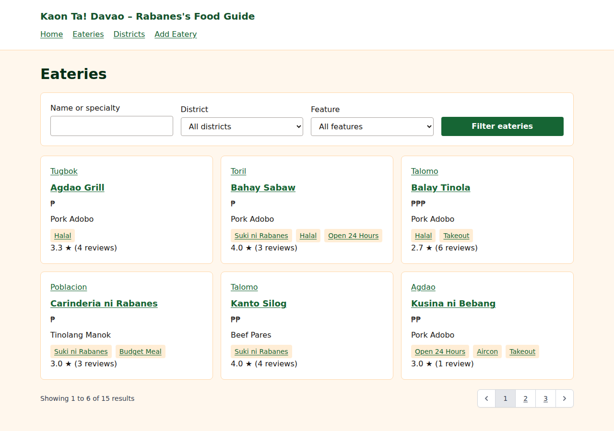
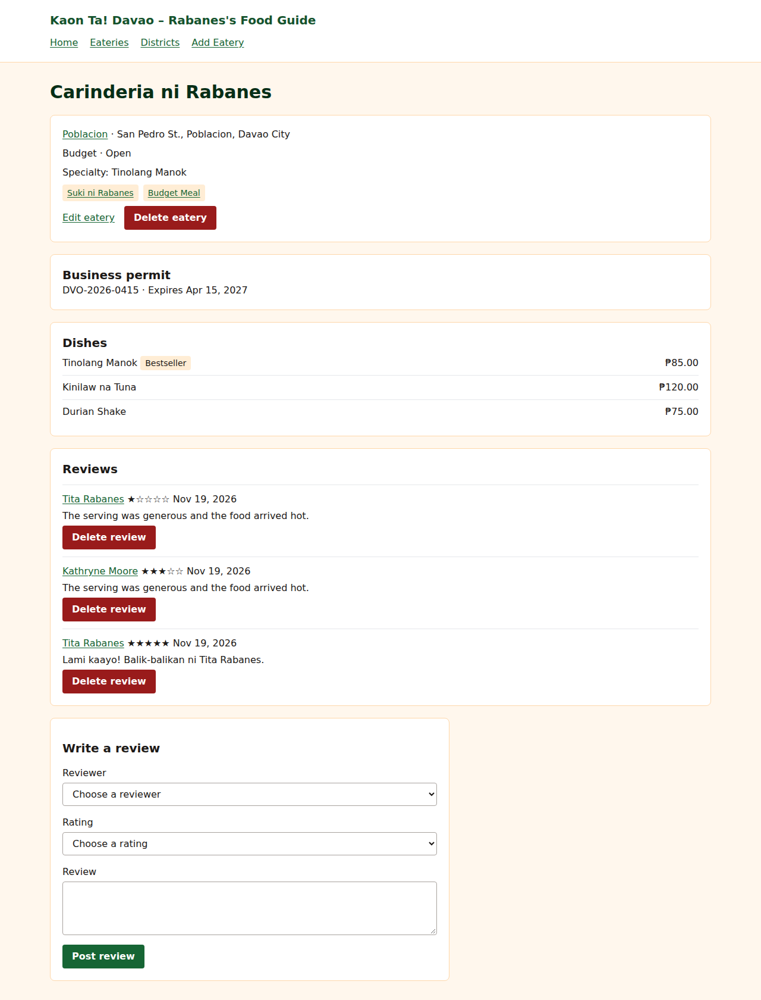
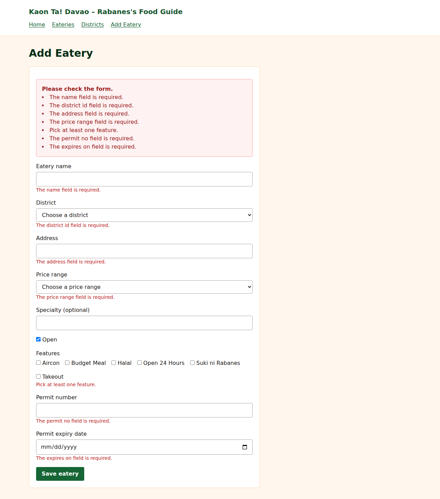

# Kaon Ta! Davao – Rabanes's Food Guide

**Jason Cedrick Principe Rabanes**  
CS Elective 2, Full-Stack Development · Prefinal milestone

A public Laravel 12 and SQLite guide to Davao eateries. Browse by district, search for a dish specialty, or choose a reviewer to leave feedback on an open eatery.

## Run locally

Use PHP 8.2+ with SQLite support, Composer, Node.js 22 LTS and npm. From the project directory:

```sh
composer install
cp .env.example .env
php artisan key:generate
touch database/database.sqlite
php artisan migrate:fresh --seed
npm install
npm run build
php artisan serve
```

Open the address printed by Artisan. The fresh migration command clears the local database and restores the sample data.

## Personalized data

| Item | Seed value |
| --- | --- |
| Districts | Poblacion, Talomo, Agdao, Buhangin, Toril, Tugbok |
| Features | Suki ni Rabanes, Budget Meal, Halal, Open 24 Hours, Aircon, Takeout |
| Reviewers | Jason Cedrick Rabanes (`rabanes@kaonta.test`) and Tita Rabanes (`tita.rabanes@kaonta.test`) |
| Eatery | Carinderia ni Rabanes (`carinderia-ni-rabanes`), open, budget |
| Address | San Pedro St., Poblacion, Davao City |
| Specialty and tags | Tinolang Manok, tagged Suki ni Rabanes and Budget Meal |
| Permit | DVO-2026-MMDD, derived from the local permit expiry date |
| Dishes | Tinolang Manok ₱85.00 (bestseller), Kinilaw na Tuna ₱120.00, Durian Shake ₱75.00 |

For the personalized class seed, set `GUIDE_DEMO_PASSWORD` to the shared password specified in Section 8 of the handout and `GUIDE_PERMIT_EXPIRY` to the required 2027 birthday date in your local `.env` before seeding. The example uses April 15 and generates random passwords if the password field is empty. The review form lets you pick a user. Tita's five-star review reads “Lami kaayo! Balik-balikan ni Tita Rabanes.”

## Relationships

| Models | Laravel relationship | How the guide uses it |
| --- | --- | --- |
| District ↔ Eatery | hasMany / belongsTo | A district lists its eateries, and each card links back to its district. |
| Eatery ↔ Dish | hasMany / belongsTo | Each menu belongs to one eatery, which can serve several dishes. |
| Eatery ↔ Permit | hasOne / belongsTo | Each eatery displays and updates its own permit. |
| Eatery ↔ Review | hasMany / belongsTo | Residents can leave several reviews for the same eatery. |
| User ↔ Review | hasMany / belongsTo | Each review has one author, whose page lists all their reviews. |
| Eatery ↔ Feature | belongsToMany in both directions | A feature such as Halal can label several eateries, and each eatery can have several features. |
| District → Review via Eatery | hasManyThrough | The district counts reviews left on its eateries without storing a district ID on each review. |

## Routes

Output of `php artisan route:list --except-vendor`

```text
GET|HEAD        / .................................... home › HomeController
  GET|HEAD        districts ....... districts.index › DistrictController@index
  GET|HEAD        districts/{district} districts.show › DistrictController@sh…
  GET|HEAD        eateries ........... eateries.index › EateryController@index
  POST            eateries ........... eateries.store › EateryController@store
  GET|HEAD        eateries/create .. eateries.create › EateryController@create
  GET|HEAD        eateries/{eatery} .... eateries.show › EateryController@show
  PUT|PATCH       eateries/{eatery} eateries.update › EateryController@update
  DELETE          eateries/{eatery} eateries.destroy › EateryController@destr…
  GET|HEAD        eateries/{eatery}/edit eateries.edit › EateryController@edit
  POST            eateries/{eatery}/reviews eateries.reviews.store › ReviewCo…
  GET|HEAD        reviewers/{user} .. reviewers.show › ReviewerController@show
  DELETE          reviews/{review} reviews.destroy › ReviewController@destroy

                                                           Showing [13] routes
```

## Screenshots

### Eatery directory



### Carinderia ni Rabanes with resident reviews



### Create form showing validation errors


